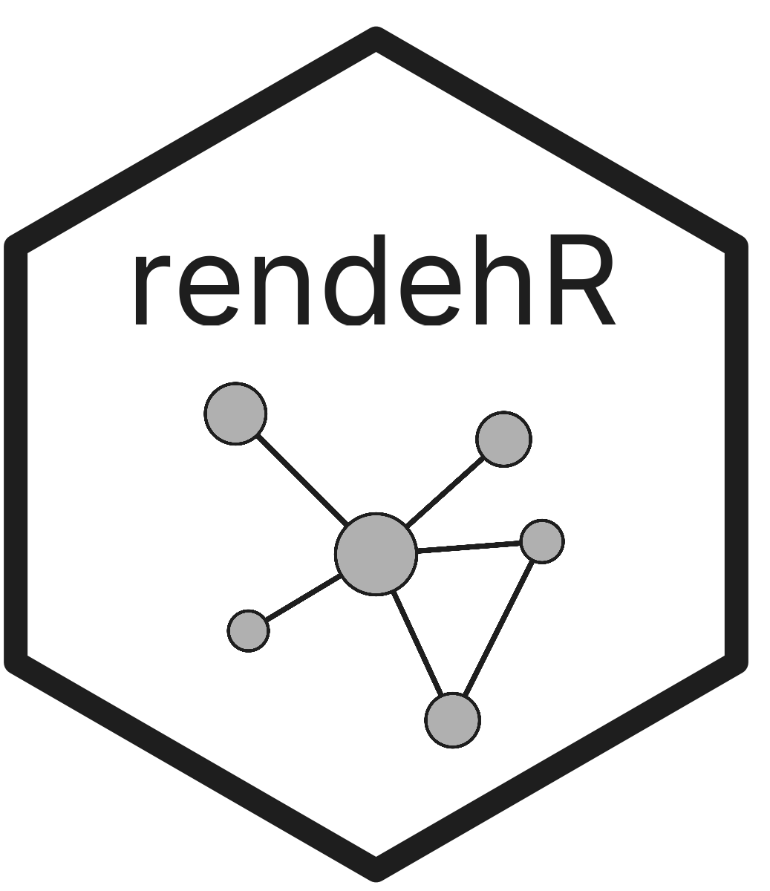
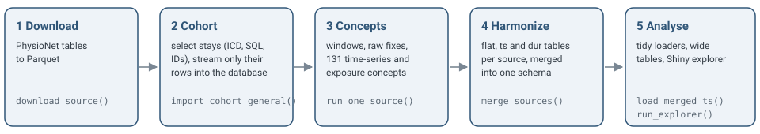

# rendehR 

<!-- badges: start -->
[](https://lifecycle.r-lib.org/articles/stages.html#stable)
[](https://github.com/ATE-DRIVEN-lab/rendehR/actions/workflows/R-CMD-check.yaml)
[](LICENSE.md)
[](https://www.r-project.org/)
<!-- badges: end -->

rendehR turns raw ICU electronic health records from MIMIC-III, MIMIC-IV
and eICU-CRD into analysis-ready, harmonized tables. It is **cohort-first**:
you define the study cohort before any large event table is imported, so only
the rows your study needs are streamed to Parquet, loaded into PostgreSQL and
processed. Every derived concept is linked to its source, extraction layer and
SQL in a provenance registry.

The output is the same for every source: one row per admission or ICU stay
(**flat**), long-format measurements (**time series**) and intervals such as
ventilation or vasopressor exposure (**durations**), merged across sources
into one schema.



## Installation

Install from GitHub:

``` r
# install.packages("pak")
pak::pak("ATE-DRIVEN-lab/rendehR")
```

The articles' plots and the cohort explorer use suggested packages (ggplot2,
shiny, plotly, DT and others). To install those as well:

``` r
pak::pak("ATE-DRIVEN-lab/rendehR", dependencies = TRUE)
```

The articles are on the [website](https://ate-driven-lab.github.io/rendehR/).
To also keep them locally as vignettes, build them while installing:

``` r
# install.packages("remotes")
remotes::install_github("ATE-DRIVEN-lab/rendehR", dependencies = TRUE,
                        build_vignettes = TRUE, force = TRUE)
```

On Linux the dependencies are compiled from source, which can take most of an
hour; [Posit Package Manager](https://packagemanager.posit.co) serves
binaries if you set it as your CRAN repository.

rendehR needs a PostgreSQL server for the full pipeline; DuckDB (installed with
the package) covers import, cohort tables and concept extraction on its own.
The interactive explorer uses the suggested packages shiny, bslib, bsicons,
plotly, DT, shinyWidgets, shinycssloaders and survival.

## Example

Build a Sepsis-3 cohort from the open MIMIC-IV demo, merge it
and read first-day summaries:

``` r
library(rendehR)

# Writes config/ehr_config.json and config/config_pass.json in the working
# directory. Add your PostgreSQL credentials to config_pass.json.
ehr_init_project(src_name = "mimic_iv_demo")
download_source("mimic_iv_demo")

# Import only the cohort's rows, then run every stage up to the
# harmonized tables.
run_one_source(
  "mimic_iv_demo",
  db_name = "sepsis_demo",
  cohort_selection = cohort_selection_options(cohort = "sepsis3")
)

# Merge one or more sources into an analysis schema ("rendehr").
merge_sources("mimic_iv_demo", db_name = "sepsis_demo")

ehr_connect("sepsis_demo")
baseline <- load_merged_flat(schema = "rendehr")
day_one  <- load_merged_ts_wide(
  schema  = "rendehr",
  spec    = list(heart_rate = c("min", "max"), lactate = "max", spo2 = "min"),
  bin_min = 24 * 60,
  window  = c(0, 0)
)
```

`list_example_cohorts()` shows the bundled cohorts (spinal cord injury and
Sepsis-3). Your own cohort can be an ICD list
(`icd_filter_path`), a list of patient or admission IDs (`direct_ids_path`),
SQL (`cohort_sql`) or an R function (`cohort_fn`).

## How it works

`run_one_source()` runs these stages in order; each one can also be called,
checked and rerun on its own:

| Stage | Function | What it does |
|:--|:--|:--|
| Cohort import | `import_cohort_general()` | Selects the cohort and streams its rows from `.csv.gz` to Parquet with DuckDB |
| Database load | `run_db()` | Loads the Parquet artifact into PostgreSQL (or a DuckDB file) |
| eICU preprocessing | `run_raw_mods()` | Builds the eICU `*_mod` tables that several concepts read |
| Visit windows | `build_window_tables()` | Admission and ICU timelines |
| Cohort table | `build_cohort_info_general()`, `build_cohort_annotations()` | One row per hospitalization, with cohort membership |
| Comorbidities | `run_comorbidities()` | Charlson and Elixhauser indices |
| Injury severity | `run_iss()` | ISS, NISS and AIS from injury diagnoses |
| Concepts | `run_concepts()`, `run_external_concepts()` | Flat, time-series and duration concepts; adapted MIT-LCP SQL |
| Harmonization | `run_harmonized_tables()` | Source-level flat, time-series and duration tables |

`merge_sources()` then combines sources at the admission or ICU-stay level.
Times are minutes since hospital admission, with minutes since ICU admission
kept where a stay exists. With `engine = "duckdb"` the cohort is built in a
local DuckDB file without PostgreSQL; the PostgreSQL-only stages are skipped.
`run_one_source_test()` resumes a partial run, and `verify_download()`,
`verify_db_load()`, `verify_cohort()`, `verify_concepts()` and
`verify_harmonized()` check each stage's output.

## Data sources

| Source | Release | ICU stays | Patients | Access |
|:--|:--|--:|--:|:--|
| MIMIC-III | 1.4 | 61,532 | 46,476 | PhysioNet credentialed |
| MIMIC-IV | 3.1 | 94,458 | 65,366 | PhysioNet credentialed |
| eICU-CRD | 2.0 | 200,859 | 139,367 | PhysioNet credentialed |
| MIMIC-III demo | 1.4 | 136 | 100 | Open |
| MIMIC-IV demo | 2.2 | 140 | 100 | Open |
| eICU-CRD demo | 2.0.1 | 2,520 | 1,841 | Open |

MIMIC-III and MIMIC-IV come from the Beth Israel Deaconess Medical Center;
eICU-CRD from 208 US hospitals. New sources are added through a source
definition, identifier mappings and concept recipes
(`vignette("adding-a-new-source", package = "rendehR")`).

## Clinical concepts

| Layer | Examples |
|:--|:--|
| Flat | Demographics, admission and discharge, length of stay, mortality |
| Time series | Vital signs, blood gases, chemistry and haematology (130 concepts) |
| Durations | Ventilation, vasopressors, antibiotics and other medication exposures |
| Repository SQL | SOFA, SAPS-II, LODS and other scores adapted from MIT-LCP MIMIC-Code and eICU-Code |
| Your own | Project SQL registered with `register_concept_sql()` |

Each concept carries its origin, citation and SQL in the provenance registry.

## Cohort explorer

``` r
run_explorer("rendehr", db_name = "sepsis_demo")   # opens http://127.0.0.1:<port>
```

A Shiny app over the merged schema: cohort overview, filters and a
characteristics table with standardized mean differences, outcomes with Wilson
95% confidence intervals, Kaplan-Meier survival, cross-tabs, a per-patient
timeline, the concept inventory with a concept builder, and project setup that
runs the pipeline as background jobs. Studies can add their own pages; the
spinal cord injury pages (`explorer_sci_data()`) are the reference example. The
app shows individual-level data and listens on `127.0.0.1` only; do not deploy
it publicly.

## Learn more

- `vignette("rendehR", package = "rendehR")`: a first project, step by step
- `vignette("projects", package = "rendehR")`: project folders, configuration and raw data
- `vignette("cohorts", package = "rendehR")`: selecting and materializing cohorts
- `vignette("pipeline", package = "rendehR")`: the stages, DuckDB and multi-source runs
- `vignette("harmonized-data", package = "rendehR")`: reading, reshaping and plotting
- `vignette("concepts", package = "rendehR")`: the concept dictionary, layers and your own SQL
- `vignette("explorer", package = "rendehR")`: the Shiny cohort explorer
- `vignette("sepsis-cohort-definitions", package = "rendehR")`: the Sepsis-3 cohort across sources
- `vignette("guided-setup-assistant", package = "rendehR")`: an interactive setup script
- `vignette("adding-a-new-source", package = "rendehR")`: registering another EHR source
- `vignette("mcp", package = "rendehR")`: the MCP server and agent skills

The documentation site is at <https://ate-driven-lab.github.io/rendehR/>.

## Validation

Each release is checked by an independent validation harness on the demo and
full datasets: raw-data oracles, concept fidelity, determinism across rebuilds,
robustness, the explorer and concordance with
[ricu](https://github.com/eth-mds/ricu). The harness is kept in the development
repository; its method and results are summarised in the
[validation article](https://ate-driven-lab.github.io/rendehR/articles/validation.html).

`devtools::test()` runs the offline test suite. Tests that need a database are
skipped unless these variables point at **disposable** resources (several tests
drop and rebuild schemas):

| Variable | Enables |
|:--|:--|
| `EHR_TEST_DB`, `EHR_CREDS_PATH` | access, merge and membership tests on a built demo database |
| `EHR_TEST_PG_DB` | PostgreSQL fixture tests (an empty scratch database) |
| `EHR_TEST_JOIN_DB` | PostgreSQL join regression tests |
| `EHR_TEST_E2E_DB`, `EHR_TEST_E2E_RAW_ROOT` | end-to-end build of the demo sources on both engines; the database name must contain `scratch` or `e2e`, and the raw root must hold `mimic_iv_demo/` and `eicu_demo/` as `download_source()` writes them |
| `EHR_TEST_EXPLORER_DB`, `EHR_TEST_EXPLORER_SCHEMA`, `EHR_TEST_EXPLORER_RAW_ROOT` | the cohort explorer on a merged schema (read only) |
| `RENDEHR_EXPLORER_SCI_DIR` and related `RENDEHR_EXPLORER_SCI_*` | the spinal cord injury explorer pages |
| `EHR_TEST_MCP_CONFIG`, `EHR_TEST_MCP_SOURCE` | the bundled MCP server's database tools (read only) |

PostgreSQL credentials come from `PGHOST`, `PGUSER` and `PGPASSWORD`.

## AI assistant integration

A local MCP server and three skills (`rendehr-user`, `rendehr-add-concept`,
`rendehr-add-source`) are bundled under `inst/mcp`; see its
[README](inst/mcp/README.md). Installing the package does not start the server
or activate the skills.

## Citation

``` r
citation("rendehR")
```

> Mussavi Rizi M, Shein V, Torres-Espin A (2026). *rendehR: Multi-Source EHR
> Harmonization Pipeline*. R package version 1.0.0,
> <https://github.com/ATE-DRIVEN-lab/rendehR>.

## License

rendehR is free software under the [GNU General Public License, version 3](LICENSE.md),
the license of ricu, on whose concept definitions part of the concept layer is
modelled. It includes SQL from MIT-LCP MIMIC-Code and eICU-Code, and its
medication list with OMOP ingredient IDs follows BlendedICU, both under the MIT
License; their notices are kept in [`inst/COPYRIGHTS`](inst/COPYRIGHTS).

## Code of Conduct

Please note that rendehR is released with a [Contributor Code of Conduct](https://ate-driven-lab.github.io/rendehR/CODE_OF_CONDUCT.html).
By contributing to this project, you agree to abide by its terms.
