The explorer is a Shiny app over a merged schema built by `merge_sources()`,
so it needs the PostgreSQL server that holds that schema to be running. It
answers the questions that come after a build: who is in the cohort, how the
sources differ, what one patient's stay looks like, which concepts were
extracted, and whether the merged tables still agree with the per-source ones.
The screenshots in this article are the MIMIC-IV demo cohort built in
`vignette("rendehR")`.

## Starting the app


``` r
run_explorer("rendehr", db_name = "rendehr_demo")
```

`run_explorer()` takes the merged schema and the same connection details as the
rest of the package: an active project (`ehr_use_config()`), a `config_path`, or
`creds`. It reads the cohort tables once at start, then queries the database
live for patient time series, concept summaries and checks.

| Argument | Use |
|---|---|
| `schema` | merged schema to show, e.g. `"rendehr"` |
| `db_name`, `config_path`, `creds` | which database, and how to connect |
| `raw_dirs` | named raw-data folders per source; enables the raw-value check on the Verify tab |
| `sci` | study pages from `explorer_sci_data()` (see [Study pages](#study-pages)) |
| `data` | a bundle from `explorer_data()` instead of loading one |
| `cache_dir` | keep the bundle between runs (see below) |
| `host`, `port`, `launch.browser` | where the app listens; `127.0.0.1` by default |

For scripts and tests, `explorer_data()` loads the same bundle and
`explorer_app()` returns the app object without running it:


``` r
data <- explorer_data("rendehr", raw_dirs = c(mimic_iv_demo = "physionet_data/mimic_iv_demo"))
app  <- explorer_app(data, live = TRUE)
shiny::runApp(app, port = 3838)
```

On full data, reading the merged tables takes a while at every start.
`cache_dir` keeps the bundle in a file that is reused until any table in the
database is rebuilt, or the package is reinstalled. The file holds
individual-level data, so it is written with owner-only permissions; keep the
directory private.

The app shows individual-level data. Keep it on `127.0.0.1` or behind your own
authentication, use it under each source's data use agreement, and do not deploy
it publicly or share screenshots of real patients.

### Conventions used on every page

- **Cohort admission**: an admission flagged as a cohort member in
  `cohort_info`; the patient's other admissions are kept as context.
- **Index admission**: a patient's first cohort admission. Patient-level views
  (the age pyramid, survival, "Count: Patients") use it.
- **Clock**: hours since hospital admission, unless a view says otherwise.
- **Small cells**: counts of 1-9 are shown as `<10`, together with any
  percentage or complement from which they could be recovered. The switch "Hide
  counts below 10" turns this off for your own screen only.
- **Dates**: shifted per patient in MIMIC; eICU-CRD has offsets only, so
  calendar views fall back to hours.
- **Help and links**: the question mark at the right of the top bar explains
  the open page and links to its section here; the link icon gives a URL that
  reopens the page with the same Cohort Explorer filters and tab settings. A link
  holds no data and never re-runs an action.
- **Plots** are interactive (zoom, hover, toggle a series in the legend); the
  camera button saves the plot as SVG.

## Overview

<div class="figure">
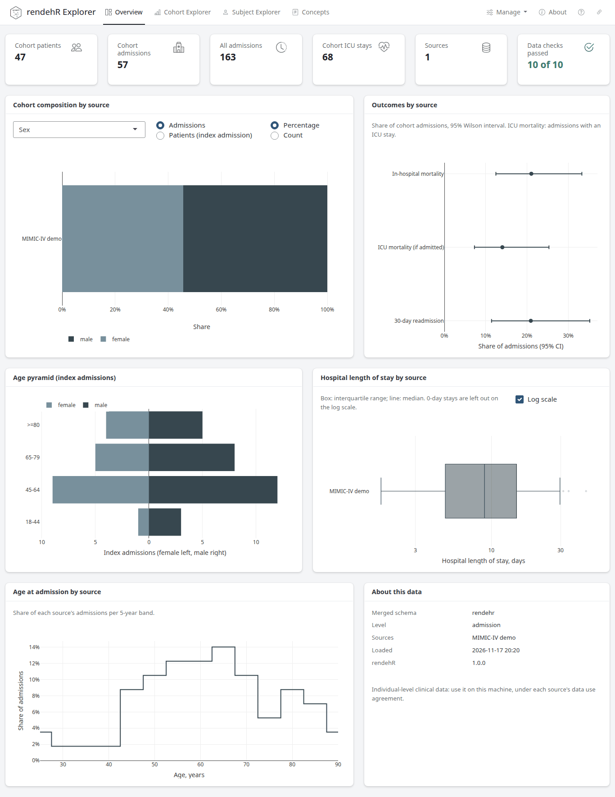
<p class="caption">plot of chunk overview</p>
</div>

The first page describes the whole cohort without filters.

- **Headline boxes**: cohort patients, cohort admissions, all admissions of these
  patients (context included), cohort ICU stays, sources, and how many structural
  data checks passed. A box turns amber when a check fails; open
  *Manage > Data checks* for the detail.
- **Cohort composition by source**: one stacked bar per source for any grouping
  variable (sex, admission type, age group, outcome, ...), as admissions or
  index admissions, in percent or counts.
- **Outcomes by source**: in-hospital mortality, ICU mortality (among admissions
  with an ICU stay) and 30-day readmission, with 95% Wilson intervals.
- **Age pyramid** of index admissions, **hospital length of stay** per source
  (box plot, log scale optional) and **age at admission** in 5-year bands.
- **About this data**: the merged schema, its level (admission or ICU), the
  sources, when the bundle was loaded and the package version.

Use it to spot a source that looks different before analysing anything: a
mortality rate far from the others or a length-of-stay distribution shifted by a
unit error is visible here first.

## Cohort Explorer

The analysis page. The sidebar filters the cohort; every tab on the right is
computed from the same filtered rows, so a table and a plot shown side by side
always describe the same admissions.

**Filters.** The sidebar starts with the number of selected admissions and the
counting unit: *Admissions* counts every cohort admission, *Patients* keeps one
index admission per patient (chosen before filtering, so a patient whose index
admission is filtered out drops out). Filters are grouped by source, patient
(sex, age, race, insurance, language), admission and outcome; each group is an
accordion that can be collapsed. *Download selection (CSV)* writes the filtered
rows with every variable the explorer knows, and *Show R code* gives the code
that reproduces the selection from `explorer_data()` with `dplyr::filter()`, so
a selection made here can move into an analysis script.

<div class="figure">
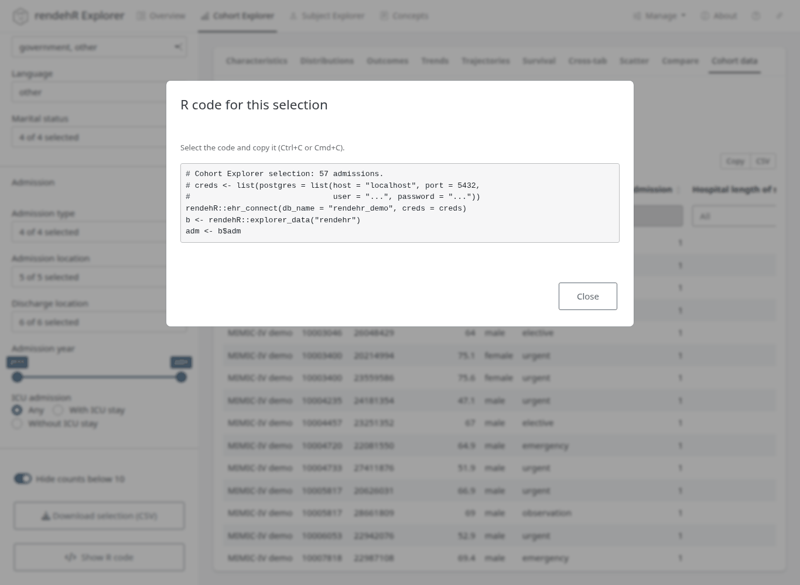
<p class="caption">plot of chunk cohort-code</p>
</div>

### Characteristics

<div class="figure">
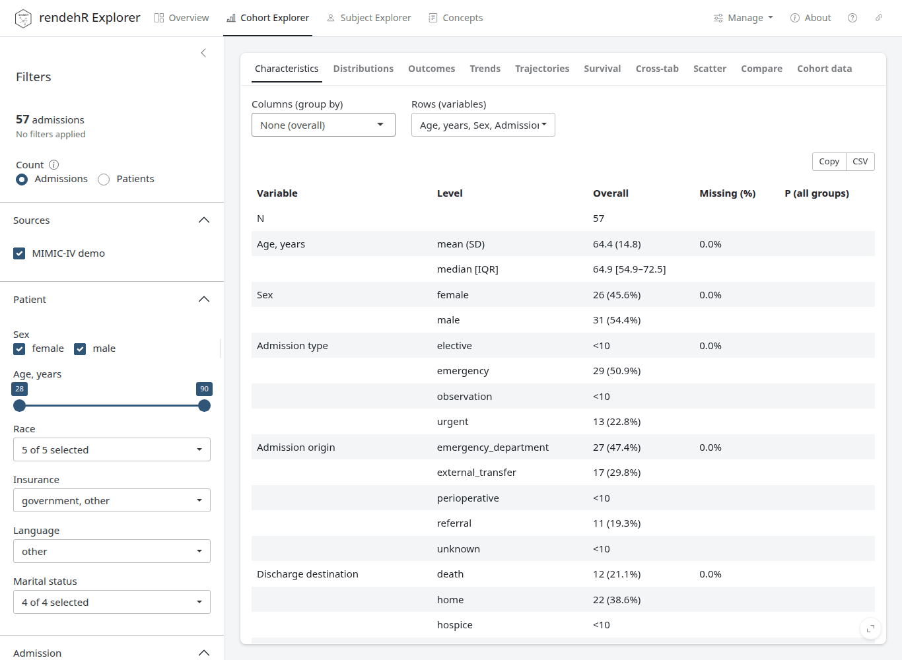
<p class="caption">plot of chunk cohort-characteristics</p>
</div>

A "Table 1": choose the grouping (*Columns*) and the variables (*Rows*).
Continuous variables show mean (SD) and median [IQR]; categorical ones show
counts and percentages; the *Missing (%)* column reports missingness per
variable. With a grouping, the table adds a p-value across all groups and a
standardised mean difference (SMD) between the two groups chosen under *SMD:
group 1 / group 2*. An absolute SMD above 0.1 is the usual threshold for an
imbalance worth reporting. *Copy* and *CSV* export the table as shown, masking
included.

### Distributions

<div class="figure">
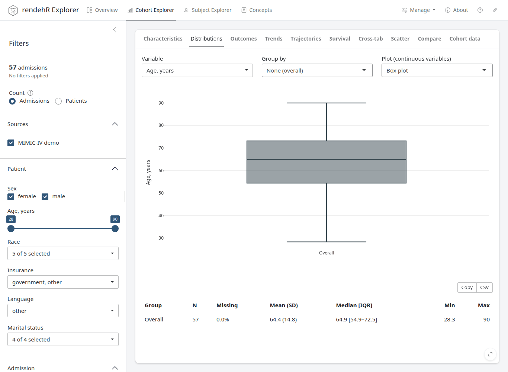
<p class="caption">plot of chunk cohort-distributions</p>
</div>

One variable, optionally split by a group. Continuous variables can be drawn as a
box plot, violin, histogram or cumulative distribution (ECDF); categorical
variables as bars. The summary table below gives n, missing, mean, SD and
quantiles per group. The ECDF is the quickest way to compare whole distributions
across sources, for example to see that one source records a laboratory value in
other units.

### Outcomes

<div class="figure">
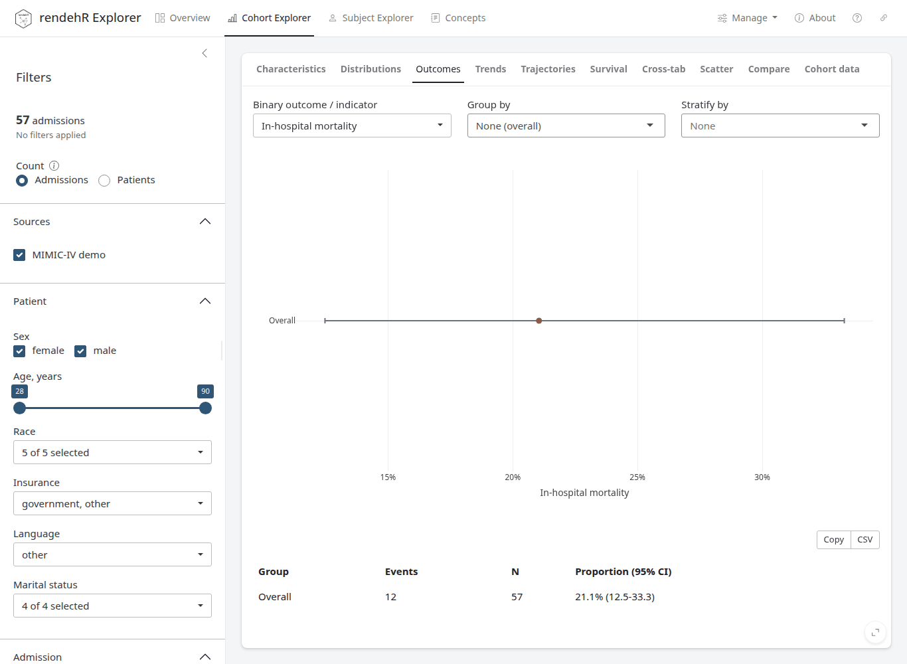
<p class="caption">plot of chunk cohort-outcomes</p>
</div>

The rate of any binary variable (mortality, readmission, ICU admission, an
exposure flag) per group, with 95% Wilson intervals, optionally stratified by a
second variable. The table lists numerator, denominator and interval for every
cell.

### Trends

<div class="figure">
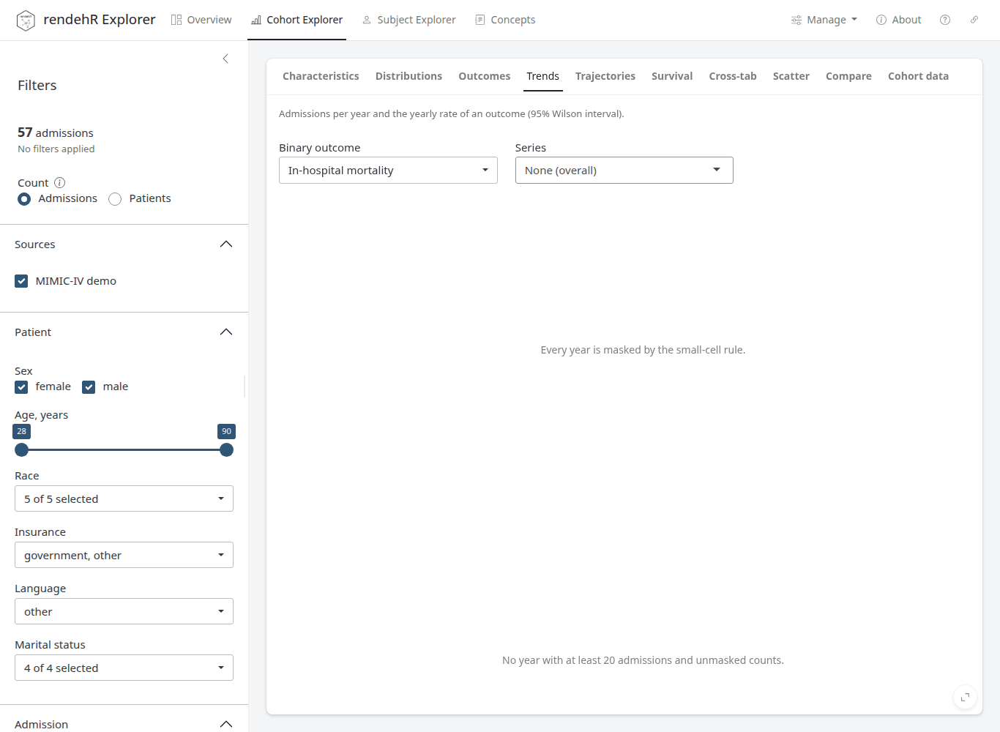
<p class="caption">plot of chunk cohort-trends</p>
</div>

Admissions per year, optionally as series by a group (counts or share of the
year), and the yearly rate of a binary outcome with its 95% interval. Years come
from the shifted admission dates, so they are comparable within a source but not
calendar years; eICU-CRD has a release year only.

### Trajectories

<div class="figure">
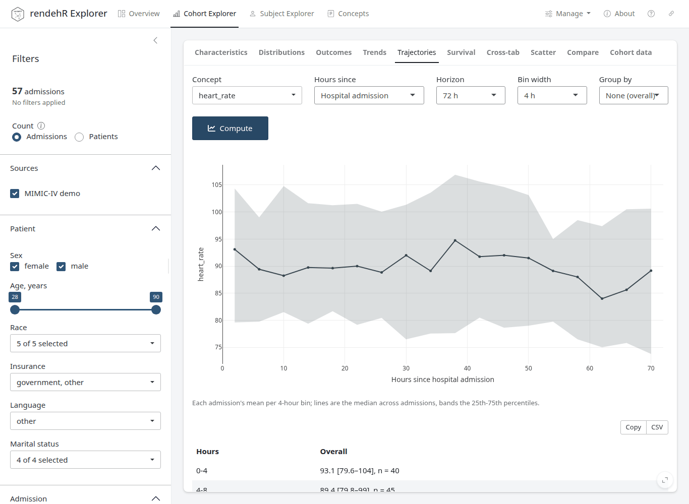
<p class="caption">plot of chunk cohort-trajectories</p>
</div>

The course of one time-series concept over the filtered cohort: each admission's
mean per time bin (1 to 24 hours) within a horizon of 24 hours to 7 days, on the
hospital or ICU clock, summarised as the median with the 25th-75th percentile
band per group. The table below gives the same numbers with the admissions per
bin. Bins with fewer than 10 admissions are left out while masking is on. Press
*Compute* after choosing the concept; the query runs once per setting.

### Survival

<div class="figure">
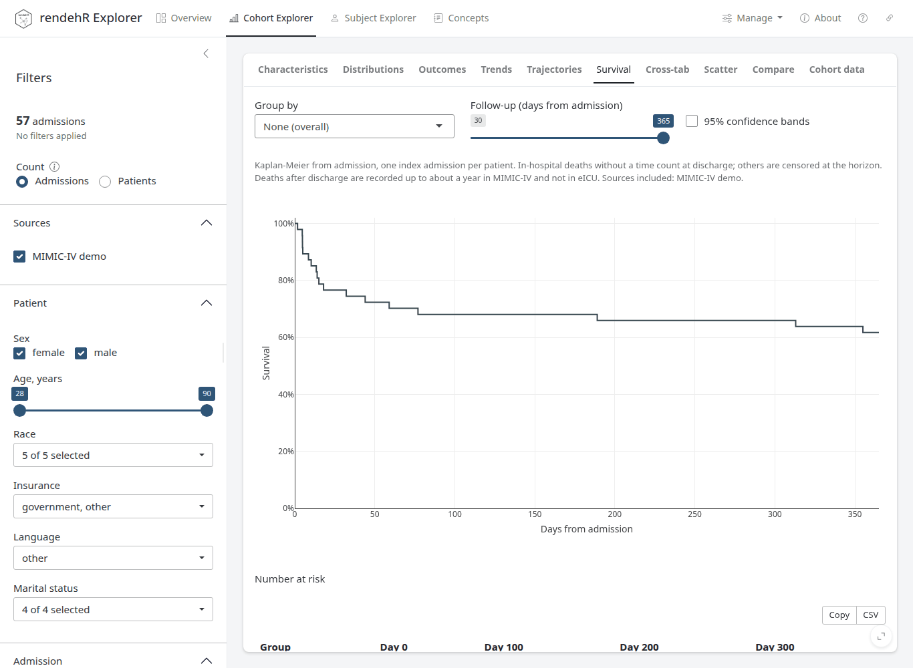
<p class="caption">plot of chunk cohort-survival</p>
</div>

Kaplan-Meier survival from hospital admission, one index admission per patient,
by group, with optional 95% confidence bands and a follow-up horizon of 30 to
365 days. In-hospital deaths without a recorded time count at discharge; other
patients are censored at the horizon. MIMIC-IV records deaths after discharge for
about a year, eICU-CRD only in hospital, so the note under the controls lists the
sources the curve can use. The number-at-risk table and a summary per group
(n, events, median survival, log-rank p-value) follow the plot.

### Cross-tab

<div class="figure">
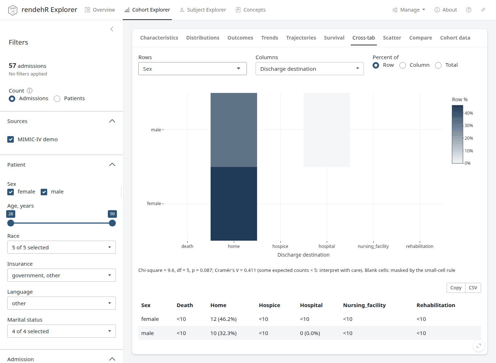
<p class="caption">plot of chunk cohort-crosstab</p>
</div>

Two categorical variables against each other, with row, column or total
percentages, a stacked bar chart, and a chi-squared test with Cramér's V; the
note warns when some expected counts are below 5.

### Scatter

<div class="figure">
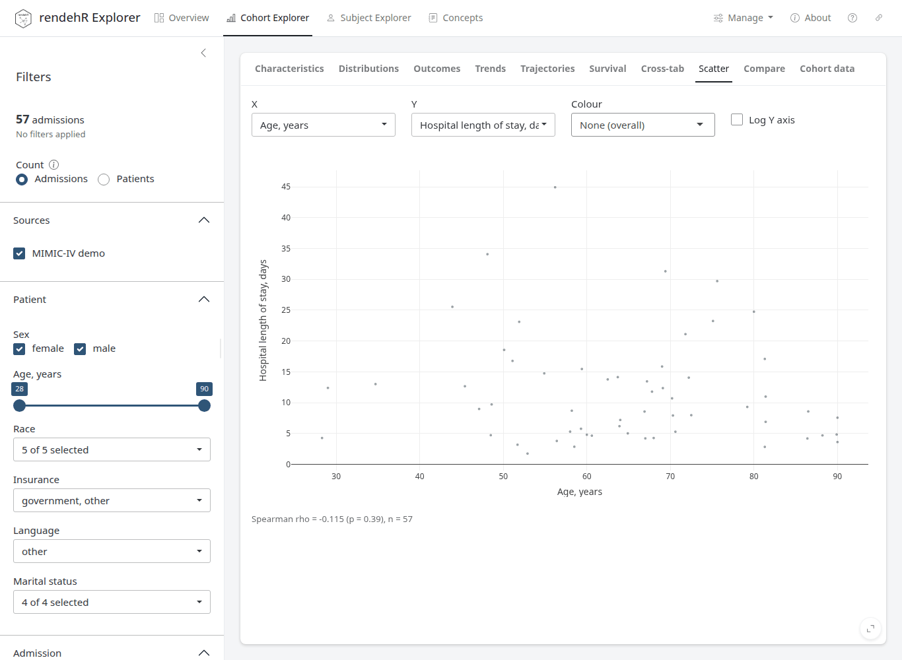
<p class="caption">plot of chunk cohort-scatter</p>
</div>

Two continuous variables, coloured by a group, with an optional log Y axis and
the Spearman correlation underneath. Each point is one admission; above 8,000
admissions a random 8,000 are plotted, while the correlation uses all of them.

### Compare

<div class="figure">
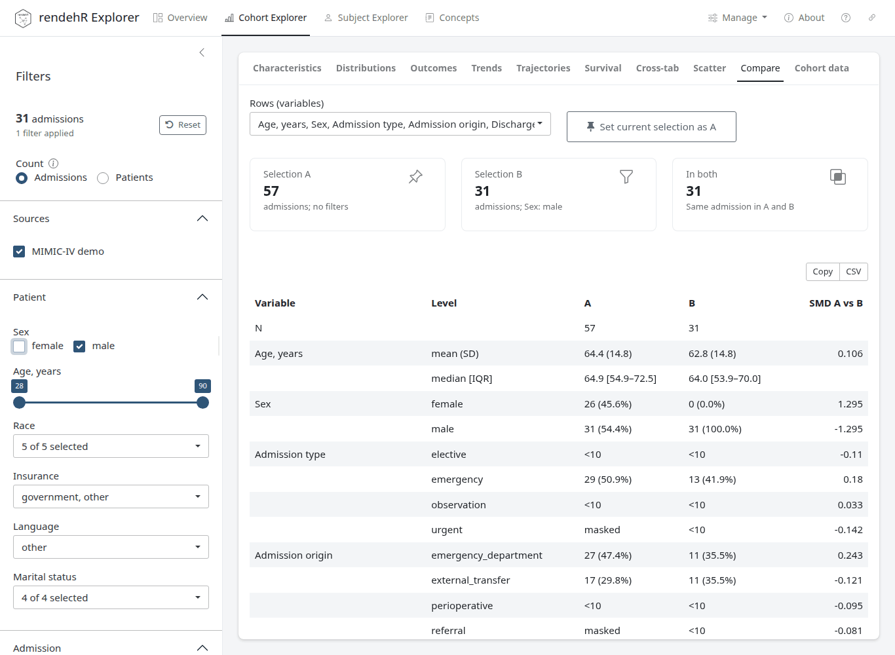
<p class="caption">plot of chunk cohort-compare</p>
</div>

Two selections made with the same filters side by side. Set the filters for the
first group and press *Set current selection as A*; then change the filters,
and the current selection is B. The boxes give the size of each and how many
admissions are in both; the table compares A with B (SMD A vs B), followed by
each binary outcome with its 95% Wilson interval. An admission in both
selections is counted in both columns.

### Cohort data

<div class="figure">
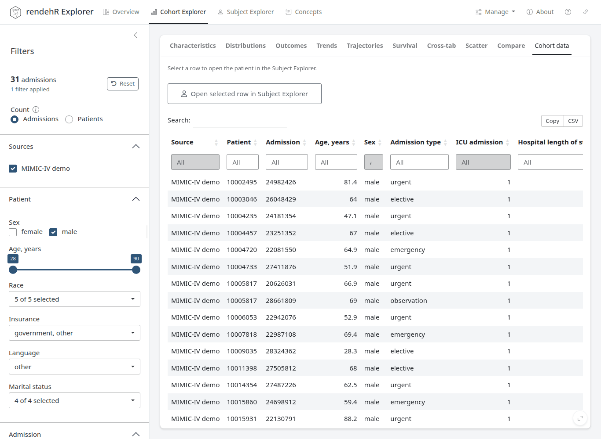
<p class="caption">plot of chunk cohort-data</p>
</div>

The filtered admissions as a searchable, sortable table. Select a row and press
*Open selected row in Subject Explorer* to see that patient.

## Subject Explorer

One patient at a time. The sidebar narrows the candidate list (source, has an
ICU stay, more than one admission, died in hospital, age at the index admission,
admission type), then *Load* opens the
patient typed in *Patient* and *Random* picks one that matches. *Time series
via* chooses where values are read from: the per-source harmonized tables
(`get_patient_ts()`) or the merged schema; the two must agree, and the Verify tab
checks that they do. When a patient has several admissions, the admission
selector switches between them.

### Timeline

<div class="figure">
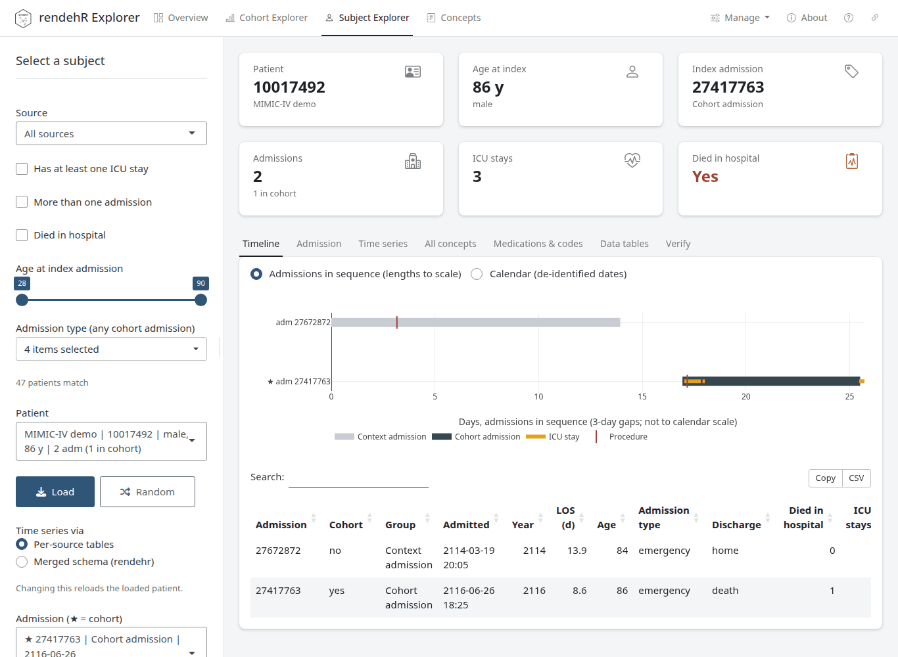
<p class="caption">plot of chunk subject-timeline</p>
</div>

Every admission of the patient, cohort and context, either in sequence with
lengths to scale or on the de-identified calendar, with ICU stays marked.
Procedures with a time are ticked on the timeline: eICU-CRD treatment offsets
and MIMIC-IV procedure dates (placed at the start of the day); MIMIC-III records
no procedure times. The table below lists admission and discharge times, length
of stay, ICU stays and outcome.

### Admission

<div class="figure">
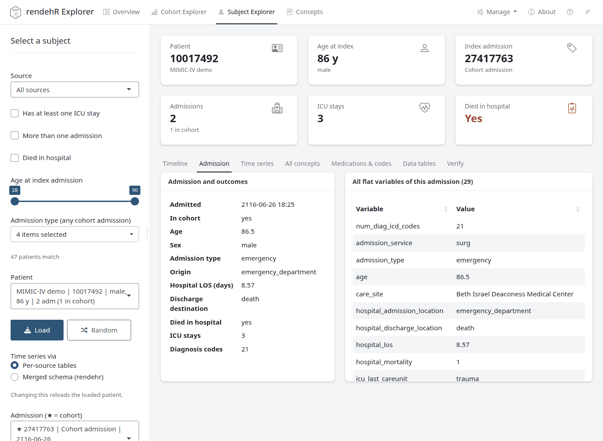
<p class="caption">plot of chunk subject-admission</p>
</div>

The selected admission: demographics, admission type and origin, outcomes and
every flat variable (`get_patient_flat()`) with its value.

### Time series

<div class="figure">
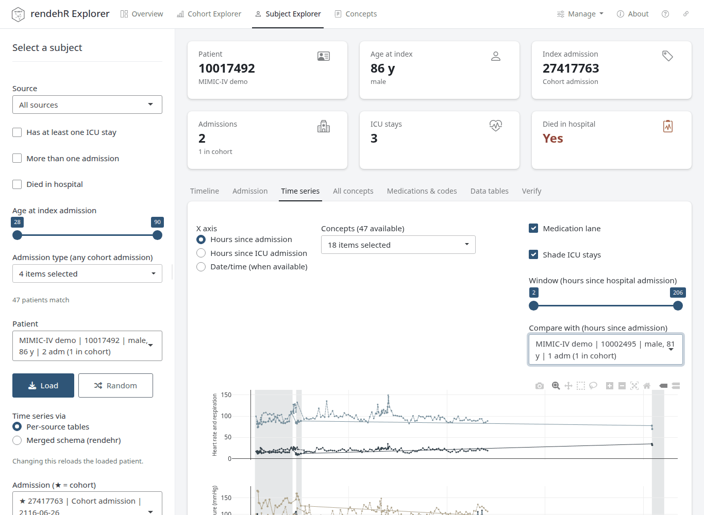
<p class="caption">plot of chunk subject-timeseries</p>
</div>

Chosen concepts on a shared time axis, in hours since hospital or ICU admission,
or on the shifted date. A medication lane under the plots shows the duration
exposures from the merged `dur` table, and ICU stays are shaded. The window
slider zooms in on part of the stay. This is the view to check a concept against
the clinical story, for example that vasopressors start when the mean arterial
pressure falls.

Click a point to see where it comes from: the value and its time, the concept's
definition for that source (table, item codes, unit and conversion from the
concept configuration) and its registered origin. *Compare with* draws a
second patient's values of the same concepts as dashed lines on the same panels
(hours since admission), for example a patient with the same diagnosis who did
not deteriorate.

### All concepts

<div class="figure">
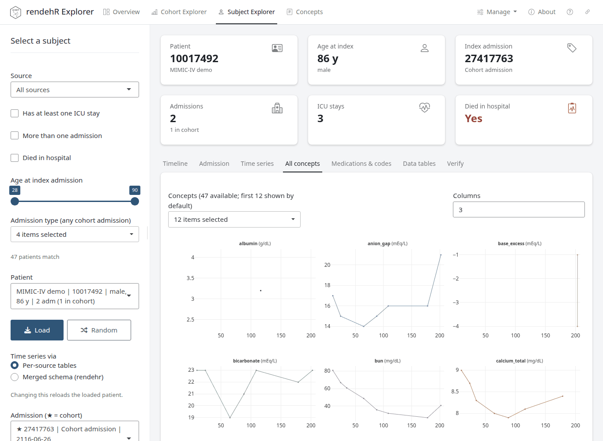
<p class="caption">plot of chunk subject-allconcepts</p>
</div>

A grid of small plots, one per concept the admission has, with a chosen number of
columns. Useful to see at a glance what was recorded and to find a concept with
implausible values.

### Medications & codes

<div class="figure">
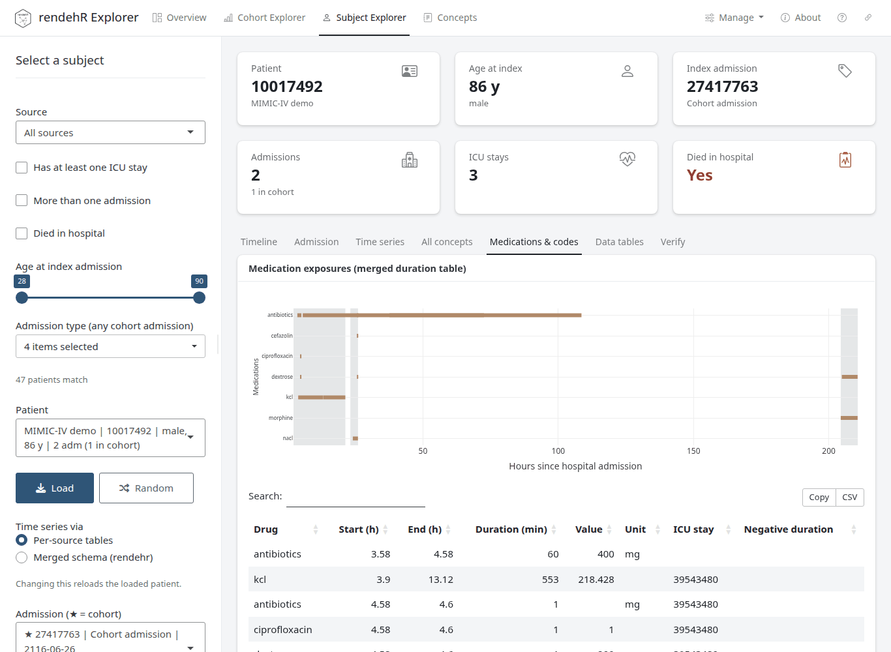
<p class="caption">plot of chunk subject-meds</p>
</div>

Medication exposures as bars over time with their start, stop and dose, followed
by the diagnosis and procedure codes of the admission with their titles.

### Data tables

<div class="figure">
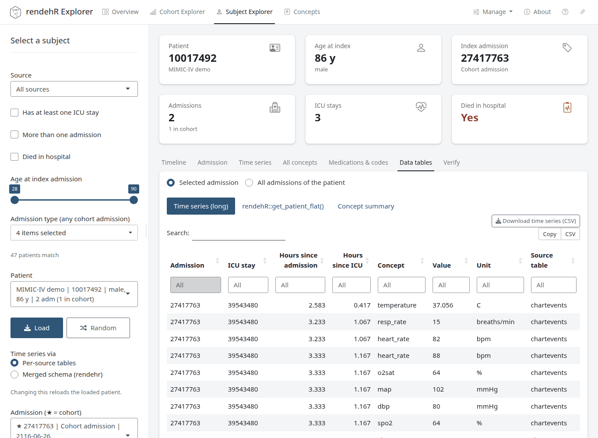
<p class="caption">plot of chunk subject-datatables</p>
</div>

The raw material behind the plots, for the selected admission or all admissions
of the patient: the long time-series table (downloadable as CSV), the output of
`get_patient_flat()`, and a per-concept summary (rows, rows with a value,
min, median, max, first and last hour, unit).

### Verify

<div class="figure">
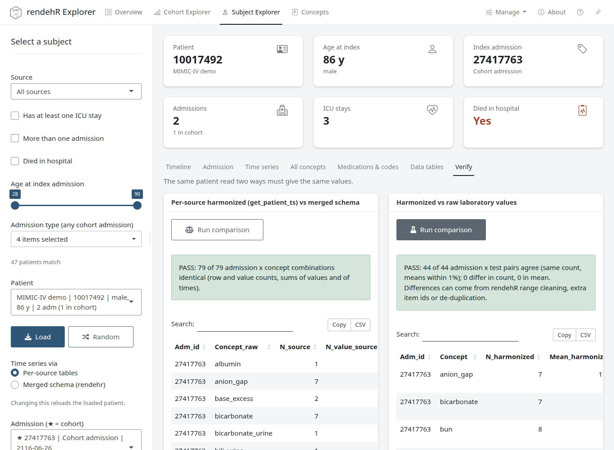
<p class="caption">plot of chunk subject-verify</p>
</div>

The same patient read two ways must give the same values.

- *Per-source harmonized vs merged schema* compares every time-series row of the
  patient in the source schema with the merged schema.
- *Harmonized vs raw laboratory values* reads the source's raw laboratory file
  (needs `raw_dirs`) and compares it with the harmonized values after unit
  conversion.
- *Structural checks* confirm that identifiers, admission windows and ICU stays
  of this patient are consistent across tables.

A mismatch here points at a merge or a concept definition, not at the patient.

## Concepts

### Concept inventory

<div class="figure">
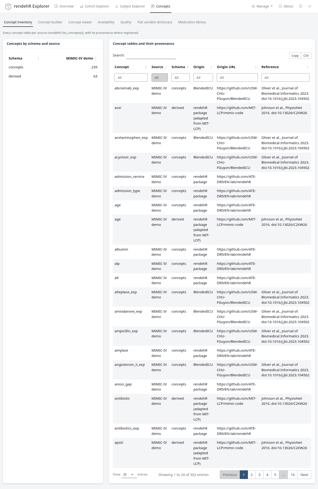
<p class="caption">plot of chunk concepts-inventory</p>
</div>

Every concept table per source (`list_concepts()`), counted by schema, with its
provenance where registered: the definition file, row and code that produced it.

### Concept builder

<div class="figure">
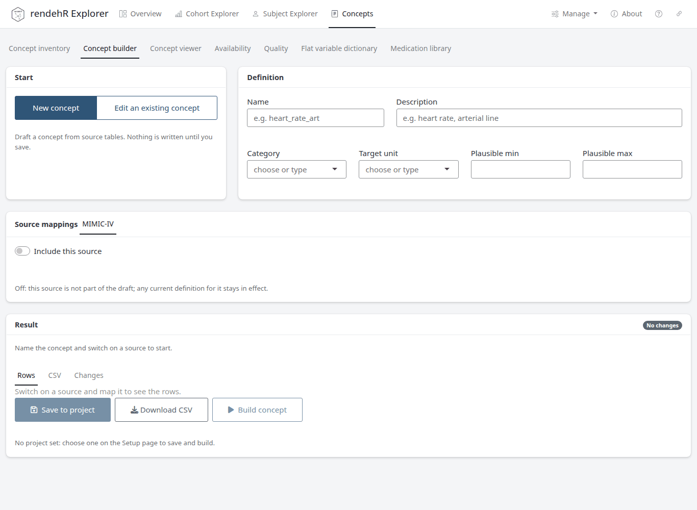
<p class="caption">plot of chunk concepts-builder</p>
</div>

Drafts a new time-series concept without writing SQL. Start from a source table
and its item dictionary, search items by label or pattern, choose the value and
unit columns, unit conversion and plausible range, then preview the result
against the database inside a read-only transaction: rows, distribution and the
CSV row that would be saved. *Save* writes a `user_concepts` file that
`run_concepts()` picks up; nothing is written to the clinical tables. The
command-line equivalent is in `vignette("concepts")`.

### Concept viewer

<div class="figure">
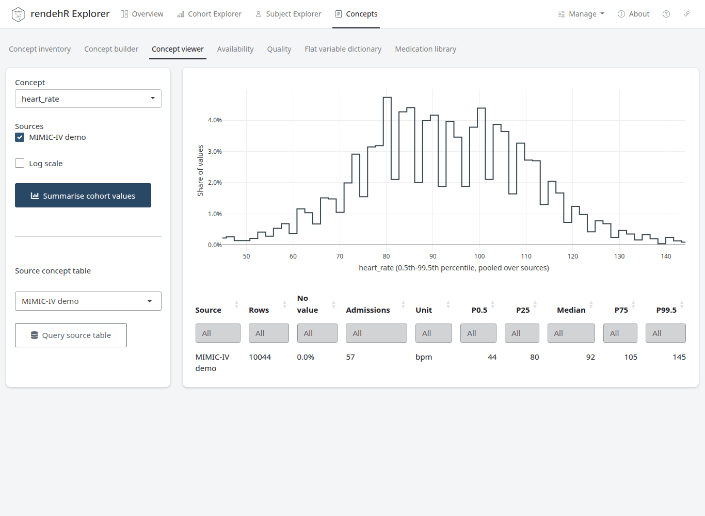
<p class="caption">plot of chunk concepts-viewer</p>
</div>

The distribution of one concept across sources for the cohort admissions, with
n, missing and quantiles per source (*Summarise cohort values*), and a direct
look at the source concept table (*Query source table*). Different distributions
across sources are the usual sign of a unit or item-selection difference.

### Availability

<div class="figure">
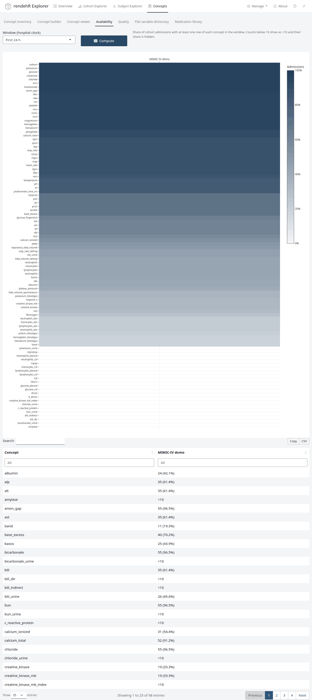
<p class="caption">plot of chunk concepts-availability</p>
</div>

Which concepts a cohort actually has: the share of cohort admissions with at
least one value of each concept in the first 24 or 48 hours of the hospital stay
or over the whole stay, as a heatmap of concepts by source and as a table. It
answers whether there is enough data for a variable before a study relies on
it, and shows where sources differ in what they record.

### Quality

<div class="figure">
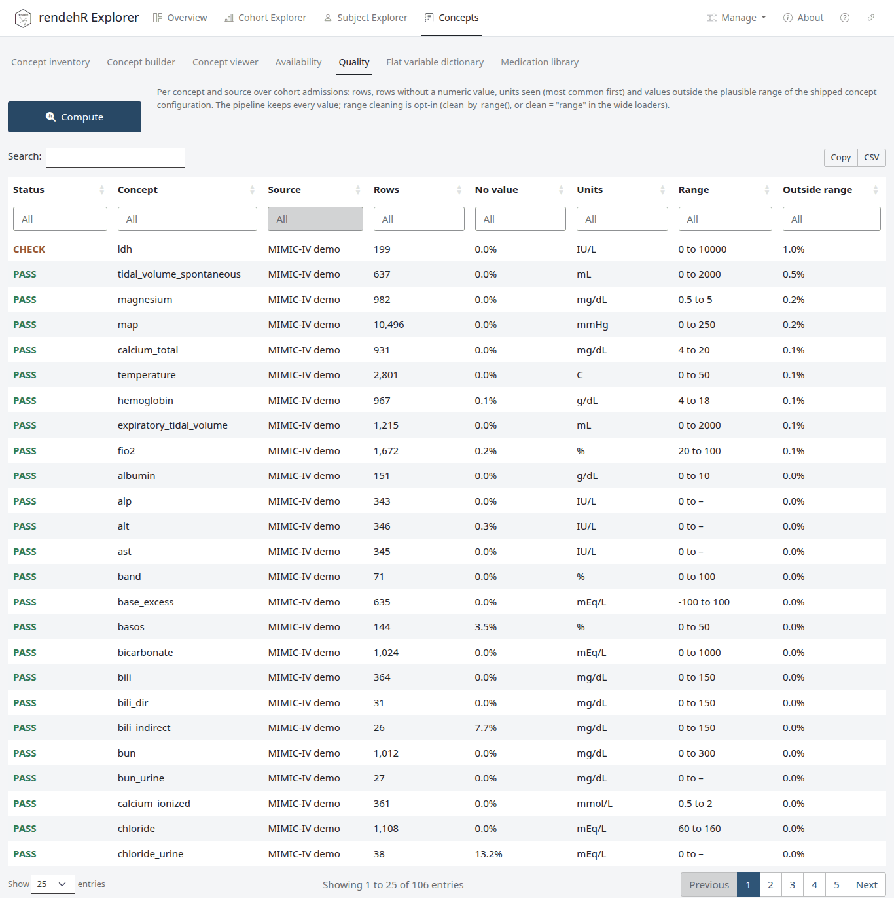
<p class="caption">plot of chunk concepts-quality</p>
</div>

Per concept and source over the cohort admissions: rows, the share of rows
without a numeric value, the units seen (most common first) and the share of
values outside the concept's plausible range from the concept configuration,
sorted by that share. *CHECK* marks more than 1% out of range or more than one
unit. The pipeline keeps every value; range cleaning is opt-in
(`clean_by_range()`, or `clean = "range"` in the wide loaders, see
`vignette("harmonized-data")`).

### Flat variable dictionary and medication library

<div class="figure">
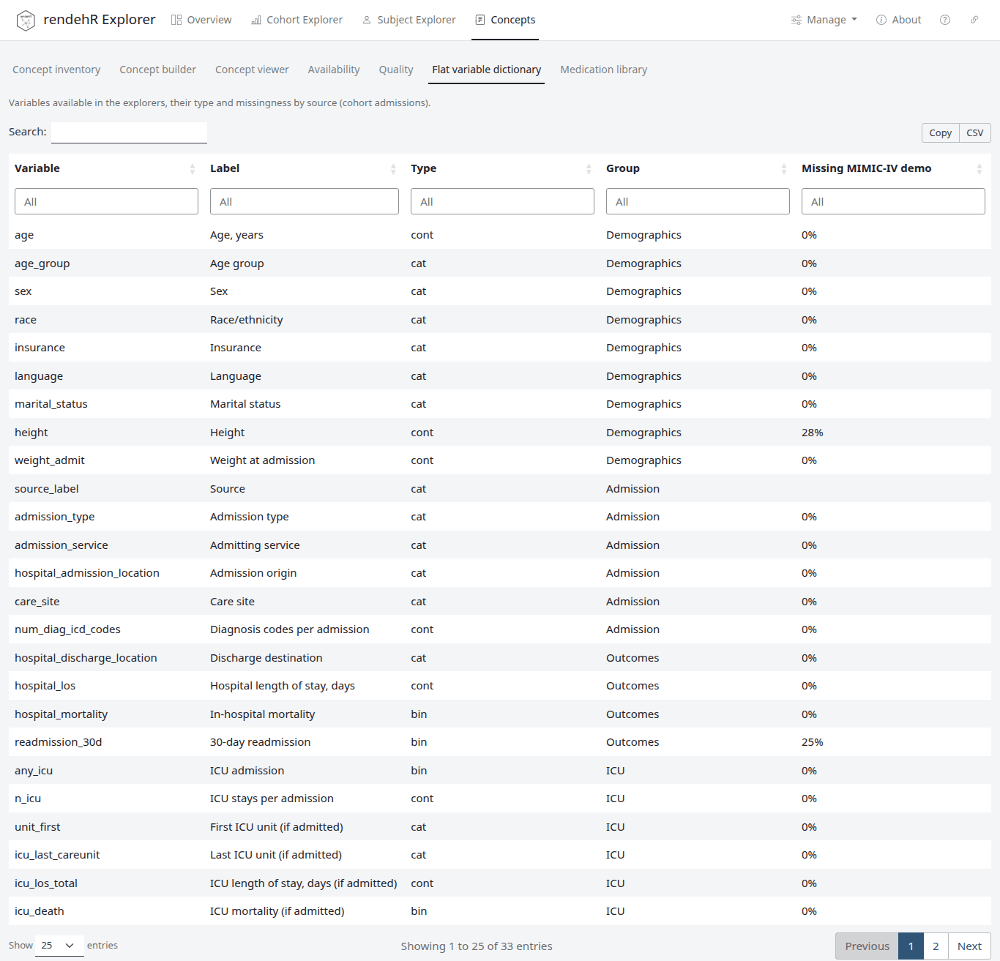
<p class="caption">plot of chunk concepts-dictionary</p>
</div>

The dictionary lists every variable the explorers can filter or plot, its type
and its missingness per source. The medication library gives the prevalence of
each exposure concept among cohort admissions, per source and as a top-25 chart.
*Exposure by day* follows chosen drugs over the first 7 or 14 days: the share of
cohort admissions exposed on each day since hospital admission, one panel per
source.

<div class="figure">
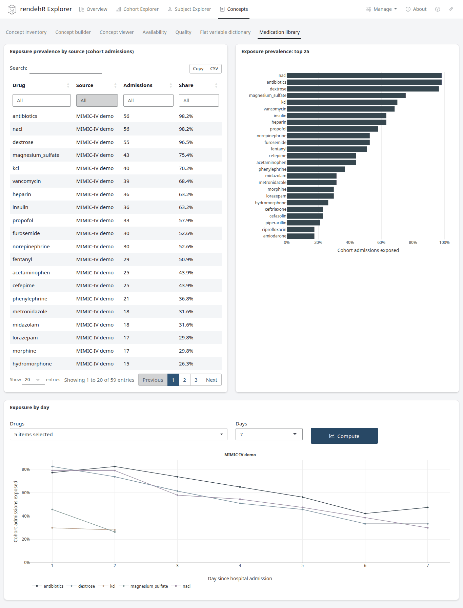
<p class="caption">plot of chunk concepts-medications</p>
</div>

## Manage

The pages under *Manage* administer projects and databases. They are the only
part of the app that changes anything, and only when you start a job; jobs run
in the background with a live log, and can be cancelled.

### Cohorts

<div class="figure">
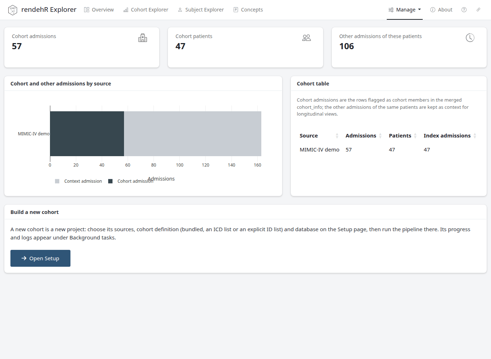
<p class="caption">plot of chunk manage-cohorts</p>
</div>

Cohort admissions, cohort patients and the other admissions of these patients
per source, and the cohort table. A new cohort is a new project; *Build a new
cohort* opens Setup with the cohort section ready.

### Setup

<div class="figure">
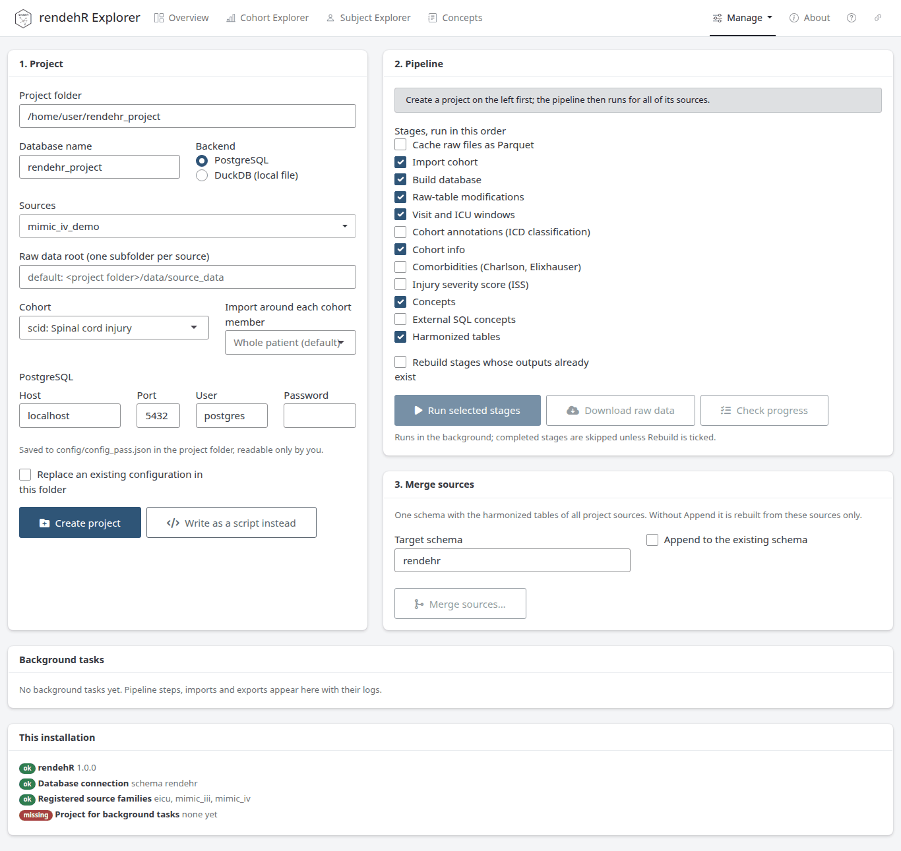
<p class="caption">plot of chunk manage-setup</p>
</div>

The pipeline without code, in three steps.

1. **Project**: folder, database name and backend (PostgreSQL or a local DuckDB
   file), sources and raw-data root, the cohort (bundled definition, ICD list or
   identifier list) and how much context to import around each member (whole
   patient, hospital admission or ICU stay). Credentials are saved to
   `config/config_pass.json`, readable only by you. *Write as a script instead*
   produces the equivalent R script.
2. **Pipeline**: download raw data (credentialed sources need a PhysioNet
   account) and run the selected stages. Completed stages are skipped unless
   *Rebuild* is ticked.
3. **Merge sources**: build one schema with the harmonized tables of all project
   sources, or append to an existing one.

### Package

<div class="figure">
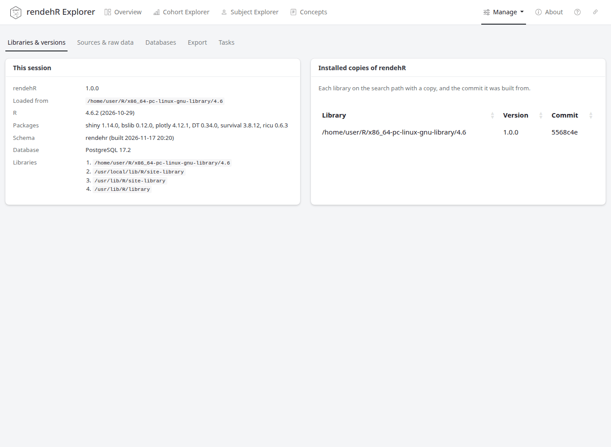
<p class="caption">plot of chunk manage-package</p>
</div>

Which rendehR copies are installed and from which commit; the registered source
families and whether their raw files and harmonized tables are present; the
`rendehr*` databases on the server (create or drop, never the connected one); and
an export of any merged table to Parquet or compressed CSV.

### Data checks

<div class="figure">
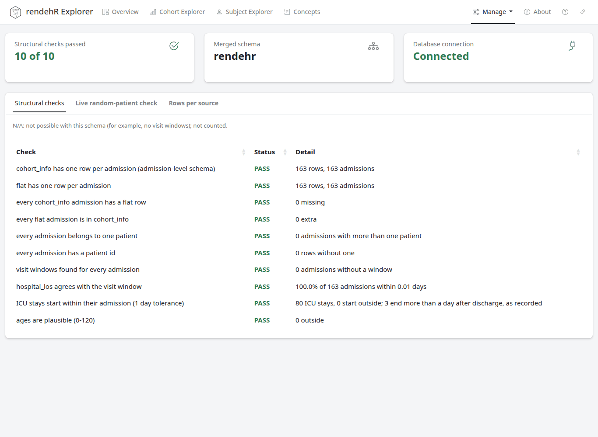
<p class="caption">plot of chunk manage-checks</p>
</div>

Structural checks of the merged schema (keys, windows, time ordering, coverage),
rows of each merged table per source, and a live check that reads random patients
from the per-source tables and from the merged schema and requires identical
values. A check that cannot apply to this schema is N/A and is not counted.

## Study pages


``` r
sci <- explorer_sci_data("analysis/outputs/explorer_data", "analysis/outputs")
run_explorer("rendehr", db_name = "rendehr", sci = sci)
```

`explorer_sci_data()` adds study-specific pages to the same app from tables a
study prepares itself; the app does not have to be edited. The packaged
reference is the spinal cord injury study: *Cohort & categories* (category rules,
code list and the mapping from source to category), *SCI-specific* (neurological
level, completeness and complications by category) and *Biomarkers*. The SCI
categories follow `scid_classify()`: a stay is SCI when any of its codes is a
cord code, and its trauma status comes from those codes only.

## Typical workflows

**Check a new build.** Open *Manage > Data checks* and run the live check; then
compare sources on *Overview*; then open a few random patients and run
*Verify*.

**Describe a cohort.** Set filters, group *Characteristics* by source or
outcome, read the SMDs, export the table; add *Outcomes* and *Survival* by the
same group. *Show R code* carries the selection into an analysis script, and the
link icon saves the view.

**Compare two groups.** Make the first selection and set it as A on *Compare*,
change the filters for B, and read the SMDs and outcome rates; *Trajectories*
grouped by the same variable shows how a concept evolves in each group.

**Check data before a study.** *Availability* tells whether the concepts a study
needs are recorded early enough in each source; *Quality* flags units and
out-of-range values to handle before analysis.

**Investigate an outlier.** Find it on *Distributions* or *Scatter*, select it on
*Cohort data*, open it in the *Subject Explorer*, and read the concept on
*Time series* against the medication lane and ICU stays.

**Add a concept.** Draft it in the *Concept builder*, preview and save it, run
`run_concepts()` and `merge_sources()` again, and check it on the *Concept
viewer*.

## Related articles

- `vignette("harmonized-data")`: the tables the app reads
- `vignette("concepts")`: the concept builder's command-line equivalent
- `vignette("cohorts")`: how the cohort behind the app was defined
